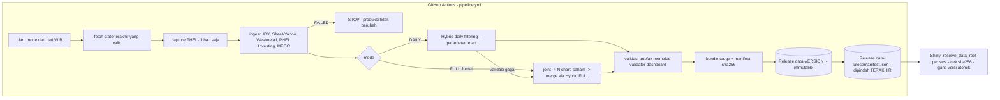

# IDX risk pipeline - otomatisasi GitHub Actions + Shiny tanpa republish

Pipeline harian (Senin-Jumat ±18.00 WIB) yang mengambil data, memvalidasi, memperbarui `raw_data.xlsx`, menjalankan
model (DAILY incremental / FULL setiap Jumat), lalu menerbitkan satu paket artefak versi-bertanda yang diikuti
dashboard Shiny **tanpa republish**.

> Baca `docs/STATUS.md` dulu: daftar apa yang sudah teruji, apa yang belum, dan apa yang masih butuh tindakan Anda.

## 1. Arsitektur



Titik penyimpanan: **GitHub Releases** (alasan di `docs/STATUS.md` bagian 4). State harian tidak di-commit ke git, jadi tidak ada
commit bot, tidak ada loop workflow, dan riwayat git tidak membengkak.

## 2. Struktur

```
.github/workflows/  pipeline.yml  phei-capture.yml  rollback.yml  ci.yml
config/             pipeline.json (aturan sumber/validasi)  r_packages.txt  r_snapshot.txt
ingest/             Python: providers, merge idempoten, run_ingest, capture_phei
apps_script/        yahoo_feed.gs (Google Sheet -> CSV untuk USDIDR & Brent)
R/                  run_pipeline.R (orkestrator)  bundle.R  common.R
pipeline/           15092026.R  Hybrid_Incremental_Update.R   (refactor non-interaktif; metodologi tidak diubah)
app/                app.R (patch 3 baris)  app_retrieval.R
scripts/            release.py  ci_run.sh  plan_mode.py  audit_log.py  install_deps.R  clean_raw_data.py
seed/raw_data.xlsx  data awal (duplikat 18 Agu-17 Sep sudah dibersihkan, baris terakhir dipertahankan)
tests/ docs/        pytest + uji R; diff terhadap file asli: docs/*.diff
```

## 0. Tes bagian data saja (lakukan ini PERTAMA)
**Actions → fetch-test → Run workflow**, pilih `check`:
- `seed` (±1 mnt): memeriksa format `seed/raw_data.xlsx` Anda: tanggal berurutan tanpa duplikat, tidak ada hari kerja yang bolong, nilai kosong = teks `NA`
  (tidak ada sel kosong), kolom sesuai config. Jalankan setelah Anda mengganti seed dengan data yang sudah dilengkapi sampai hari ini.
- `probe` (±2 mnt, tidak menulis apa pun): menjangkau tiap sumber dan menampilkan OK/FAIL, baris, tanggal terbaru, dan kolom
  **"can it fill the gap?"**: apakah riwayat sumber itu cukup panjang untuk menutup gap dari tanggal data terakhir Anda sampai hari ini.
- `ingest` (±5 mnt): menjalankan ingestion sungguhan pada **salinan** `seed/raw_data.xlsx` dan menampilkan SEMUA baris baru (dari hari setelah data
  terakhir sampai hari kerja terakhir yang sudah final), status tiap instrumen, dan sel yang ditulis `NA`. Hasilnya bisa diunduh dari **Artifacts**
  (3 hari). Produksi tidak tersentuh.
Tidak butuh R. Perlu secret `SRC_YAHOO_SHEET_CSV` untuk USDIDR dan Brent.

## 0b. Melengkapi data sampai hari ini sebelum deploy
1. Lengkapi `raw_data.xlsx` Anda sampai hari kerja terakhir, dengan format yang sama (semua hari kerja ada; libur = nilai terakhir dibawa; kosong = teks `NA`).
2. Ganti `seed/raw_data.xlsx` dengan file itu, lalu jalankan `fetch-test` dengan `check = seed`. Perbaiki semua **Errors**.
3. IBPRCPI: PHEI hanya menampilkan 2 hari terakhir. Tambahkan satu baris ke `seed/phei_history.csv`: `TANGGAL-DATA-TERAKHIR,NILAI,last`
   (nilai dari phei.co.id pada tanggal itu). Pemeriksa seed memperingatkan bila baris ini belum ada.
4. Push ke GitHub. Pipeline lalu mengisi mulai hari kerja setelah data terakhir sampai hari kerja terakhir yang sudah final.

## 1b. Di mana data disimpan
| Apa | Lokasi |
|---|---|
| Data awal Anda (sampai 8 Okt 2026) dan 2 nilai PHEI nyata | file di repo: `seed/raw_data.xlsx`, `seed/phei_history.csv` (dipakai sekali, run pertama) |
| Tes `fetch-test` | tidak menyimpan apa pun; mode `ingest` melampirkan hasil sebagai artifact 3 hari |
| Data produksi yang terus bertambah (`raw_data.xlsx`, model, hasil) | **GitHub Releases** repo Anda: `data-latest` (penunjuk) dan `data-<versi>` (isi). Bukan file di git |
| Riwayat harian PHEI (halaman hanya menampilkan 1 hari) | Release `phei-history` |
| Feed Yahoo (USDIDR, Brent) | Google Sheet Anda, tab `feed` (diterbitkan sebagai CSV) |

PHEI: IBPRCPI hanya bisa disambung bila PHEI ditangkap **setiap hari kerja** (workflow menjalankannya otomatis). Hari yang terlewat membuat IBPRCPI
berstatus FAILED sampai Anda mengisinya, tidak pernah diisi tebakan.

## 3. Setup dari repository kosong

1. Buat repo **privat** (data turunan Bloomberg: cek lisensi sebelum membuatnya publik). Upload seluruh isi folder ini.
2. *Settings → Actions → General → Workflow permissions* = **Read and write**.
3. *Settings → Secrets and variables → Actions → Variables*: tambah `EXPECTED_REPOSITORY` = `owner/nama-repo`
   (pengaman agar workflow menolak berjalan di fork/repo salah). Untuk FULL: `FULL_SHARDS` (mis. 20) atau `FULL_RUNNER_LABEL`; opsional `RUNNER_LABEL`, `FULL_MAX_PARALLEL`.
4. Secrets: **satu wajib**: `SRC_YAHOO_SHEET_CSV` (URL CSV terbitan Google Sheet feed Yahoo; cara membuatnya di `docs/SHEETS_FEED.md`).
   `GITHUB_TOKEN` otomatis. Opsional `PROXY_URL` bila IP GitHub diblokir sumber.
5. Jalankan **Actions → pipeline → Run workflow**: `mode=FULL`, `dry_run=true`. Ini run pertama (belum ada model, jadi FULL
   memang wajib). Dry run menghitung semuanya tapi tidak menerbitkan; **catat durasi & memori** dari log (belum pernah saya ukur).
6. Jika hijau, jalankan lagi dengan `dry_run=false`. Setelah itu jadwal otomatis berjalan sendiri.
7. Jadwal: `0 11 * * 1-5` UTC = 18.00 WIB (UTC+7, tanggal sama, tanpa pergantian hari). GitHub boleh menunda; Jumat ditentukan dari
   hari **WIB saat run**, bukan dari string cron. Repo publik: GitHub menonaktifkan jadwal setelah 60 hari tanpa aktivitas.

Konsekuensi waktu: Brent/emas/kurs/LQ.F baru final ±08.00 WIB esok hari, jadi run 18.00 WIB memfinalkan baris sampai **hari kerja
kemarin** (baris Jumat masuk pada run Senin). Itu disengaja agar tidak menyimpan bar yang belum selesai.

**FULL ±24 jam vs batas 6 jam GitHub-hosted:** FULL dapat dipecah per saham menjadi N job pendek (`FULL_SHARDS`), atau dijalankan di runner
self-hosted (`FULL_RUNNER_LABEL`). Tanpa keduanya, Jumat menjalankan DAILY dan memberi peringatan "FULL SKIPPED". Baca `docs/RUNTIME.md`
(termasuk kalibrasi jumlah shard yang WAJIB dilakukan sebelum dijadwalkan).

## 4. Deploy Shiny (satu kali)

1. Buat PAT *fine-grained*: GitHub → Settings → Developer settings → Fine-grained tokens → repository access **hanya repo ini**,
   permission **Contents: Read-only**, kedaluwarsa ≤90 hari (jadwalkan pembaruan).
2. Di folder `app/` buat `.Renviron` (jangan di-commit; sudah di `.gitignore`):
   ```
   DATA_REPO=owner/nama-repo
   DATA_GITHUB_TOKEN=github_pat_xxx
   DATA_REFRESH_SECONDS=300
   ```
3. Deploy `app/app.R` + `app/app_retrieval.R` + `.Renviron` (mis. `rsconnect::deployApp("app")`). Token hanya dipakai di server R,
   tidak pernah dikirim ke browser. Dokumentasi/forum Posit yang saya temukan menyebut shinyapps.io tidak punya UI variabel
   lingkungan sehingga `.Renviron` ikut bundel; **verifikasi untuk platform Anda**.
4. Sesi baru memeriksa pointer `data-latest` (maks. tiap 300 dtk), mengunduh bundel, memverifikasi sha256 bundel + tiap file +
   RDS terbaca, baru berpindah. Gagal/korup/offline → tetap di versi valid terakhir.

**Verifikasi tanpa republish:** catat `data$raw_max_date` di `manifest.json` rilis `data-latest`; setelah run terjadwal berikutnya
buka dashboard di sesi baru (atau tunggu ≤5 mnt) dan pastikan tanggal data terbaru berubah, padahal Anda tidak deploy apa pun.
Sesi yang sudah terbuka tidak berganti sampai dimuat ulang.

## 5. Operasional

- **Manual run:** Actions → pipeline → Run workflow (pilih DAILY/FULL; `dry_run` default true).
- **Membaca log:** ringkasan ada di halaman run (Summary): status, tanggal data, instrumen gagal, hasil cek definisi; artefak
  `audit-<run_id>` berisi `audit/run.json`, `ingest_result.json`, `run_result.json`, log hybrid, audit CSV per saham.
- **Status:** `SUCCESS`, `PARTIAL_SUCCESS` (terbit, tapi ada peringatan/instrumen opsional gagal; job tetap hijau dengan annotation),
  `UP_TO_DATE` (tidak ada hari baru; tidak ada estimasi, tidak ada tulis ulang), `FAILED` (job merah, produksi tidak berubah, issue dibuka).
- **Pulihkan versi lama:** Actions → rollback → isi `tag` (mis. `data-2026...-123`, lihat tab Releases). Bundel diverifikasi sha256 dulu.
  Fetch otomatis juga mundur ke versi sebelumnya bila versi terbaru korup.
- **Jangan di-commit/publikasikan:** `.env`, `.Renviron`, token, `work/`, `dist/`, `audit/`, backup model.

## 6. Pengujian
`python -m pytest tests` (35 tes) dan `REPO_ROOT=$PWD Rscript tests/R/test_hybrid.R` (20 cek). Lihat `docs/STATUS.md` untuk batasannya.
